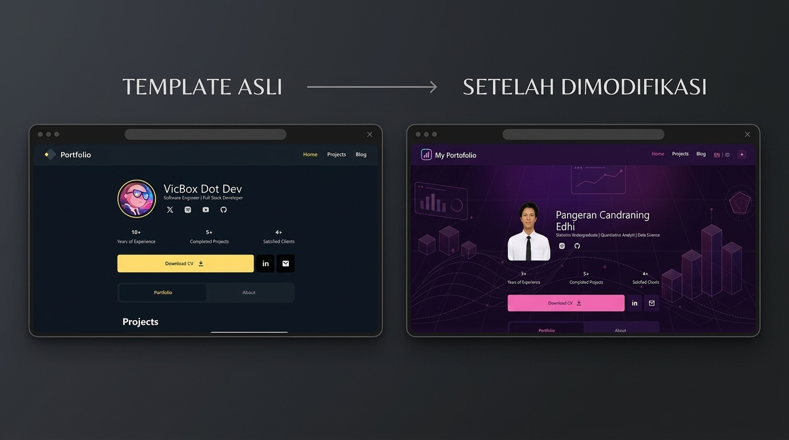

# Web Portofolio Pribadi — Pangeran Candraning Edhi

"Situs ini dibuat untuk menampilkan profil akademik, latar belakang pendidikan di Program Studi Statistika FMIPA Universitas Cenderawasih, portofolio proyek dan kegiatan, serta formulir kontak interaktif."


🌐 **Tautan Situs Publik:** [https://panca0901.github.io](https://panca0901.github.io)

---

## 🎨 Kredit Tema Dasar
Situs ini dikembangkan dan dikustomisasi dari tema gratis berikut:
* **Nama Tema:** Simple Portfolio
* **Pembuat Tema:** VicBox Dot Dev (`vicbox.dev`)
* **Tautan Tema:** [Galeri Tema Astro - Simple Portfolio](https://astro.build/themes/details/simple-portfolio/)

---

## Perubahan & Fitur Tambahan yang Dikerjakan
Dibandingkan dengan template asli, berbagai kustomisasi konten, tampilan, dan fungsionalitas telah ditambahkan:

1. **Kustomisasi Identitas & Konten Akademik**
   - Mengubah seluruh informasi profil, bio, statistik ringkas, serta latar belakang pendidikan (*S1 Statistika Universitas Cenderawasih* dan *SMAN 4 Jayapura*).
   - Mengganti logo, favicon, skema warna aksen, serta menyusun 5 dokumentasi proyek dan kegiatan (*Mathematics Bootcamp Training Program*, *OSIS × Ganesha Operation Strategic Collaboration*, *SMAN 4 Jayapura Graduation Committee*, *Charity Visit & Community Service*, dan *OSIS/MPK Basic Leadership Training*) menggunakan *Astro Content Collections* (`.mdx`).
2. **Fitur Dua Bahasa (Inggris & Indonesia — `EN | ID`)**
   - Menambahkan tombol pengalih bahasa di bilah navigasi yang menerjemahkan seluruh konten halaman Beranda, Pendidikan, Kartu Proyek, Halaman Detail Proyek, hingga Halaman Kontak secara dinamis menggunakan `localStorage` dan kamus terjemahan terintegrasi.
3. **Mode Gelap & Mode Terang (*Dark / Light Mode*)**
   - Menambahkan tombol sakelar tema di bagian *header* beserta penyesuaian kontras warna teks pada mode terang maupun gelap.
4. **Halaman Proyek Terpisah & Galeri Dokumentasi**
   - Setiap proyek memiliki halaman detail masing-masing (`/projects/[id]`) yang memuat gambar sampul, kategori/tag, ringkasan, deskripsi lengkap dua bahasa, serta tautan dokumentasi eksternal.
5. **Formulir Kontak Fungsional (`/contact`)**
   - Mengganti halaman blog bawaan menjadi halaman kontak interaktif yang terhubung dengan layanan **Web3Forms API**, sehingga pesan dari pengunjung langsung terkirim ke email pribadi.
6. **Tombol Unduh CV & Navigasi Mulus (*View Transitions*)**
   - Menyediakan tombol *Download CV* pada bagian profil utama, efek transisi antarhalaman yang halus, serta pengalihan otomatis (`/home` ke `/`) untuk mencegah galat 404.
7. **SEO Dasar & Responsivitas**
   - Dilengkapi metadata judul, deskripsi halaman, gambar *Open Graph*, dan tata letak responsif untuk tampilan perangkat seluler maupun desktop.
8. **Kustomisasi Tema Visual & Latar Belakang 3D Data Dashboard:** Mengubah palet warna dasar menjadi tema Deep Purple & Magenta dengan ilustrasi vektor SVG 3D Isometric Data Dashboard beranimasi halus yang selaras dengan bidang Statistika & Data Science.


---

## 🖼️ Perbandingan Tampilan (*Before vs After*)



---

## 🚀 Cara Menjalankan Proyek Secara Lokal

Pastikan **Node.js (versi LTS)** dan **Git** sudah terpasang di komputer Anda.

1. **Kloning repositori ini:**
   ```bash
   git clone https://github.com/Panca0901/panca0901.github.io.git
   cd panca0901.github.io
   ```

2. **Pasang seluruh dependensi proyek:**
   ```bash
   npm install
   ```

3. **Jalankan server pengembangan lokal:**
   ```bash
   npm run dev
   ```

4. **Buka di peramban (*browser*):**
   Akses alamat `http://localhost:4321` untuk melihat pratinjau situs secara langsung.

---

## 👤 Kontak
* **Nama:** Pangeran Candraning Edhi
* **Program Studi:** Statistika, FMIPA, Universitas Cenderawasih
* **GitHub:** [@Panca0901](https://github.com/Panca0901)
